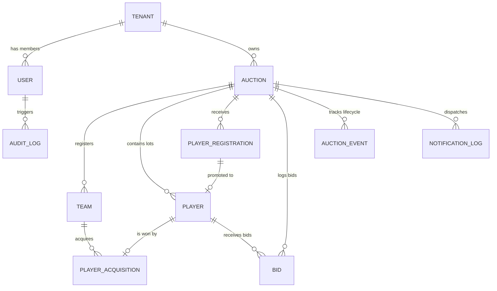

# Database Schema & Entity-Relationship Design — CBid

## 1. Database Overview & Technology Choice

CBid utilizes **MongoDB** paired with **Mongoose ODM**.

### Rationale
- **Flexible Schema for Cricket Statistics:** Cricket player statistics, tournament rule ladders, and bid events vary widely between formats (T20, T10, Hundred) and auction types (Money in LKR vs. Points). MongoDB's document model provides natural support for polymorphic attributes.
- **Atomic Operations & ACID Multi-Document Transactions:** Live bidding requires strict guarantees. MongoDB replica sets provide ACID transactions for lot hammer events where player status update, team purse deduction, and acquisition records must succeed or fail together.
- **High-Throughput Timeseries & Event Logs:** Millions of live bidding ticks and telemetry events can be rapidly ingested and queried with index optimization.

---

## 2. Entity-Relationship (ER) Model



---

## 3. Schema Definitions & Field Specifications

### 3.1 `Tenant` Collection
Represents an isolated organisation workspace (Model A SaaS subscriber or Model B Managed entity).
```javascript
{
  _id: ObjectId,
  name: { type: String, required: true, trim: true },
  slug: { type: String, required: true, unique: true, lowercase: true }, // e.g., "slc-premier"
  contactEmail: { type: String, required: true },
  contactPhone: { type: String },
  subscriptionPlan: { 
    type: String, 
    enum: ['FREE_TRIAL', 'PRO_TOURNAMENT', 'ENTERPRISE'], 
    default: 'PRO_TOURNAMENT' 
  },
  status: { type: String, enum: ['ACTIVE', 'SUSPENDED'], default: 'ACTIVE' },
  branding: {
    logoUrl: String,
    primaryColor: { type: String, default: '#0F172A' },
    accentColor: { type: String, default: '#06B6D4' }
  },
  createdAt: Date,
  updatedAt: Date
}
```

### 3.2 `User` Collection
Platform users: Super Administrators, Tournament Organisers, Auctioneers, and Team Representatives.
```javascript
{
  _id: ObjectId,
  tenantId: { type: ObjectId, ref: 'Tenant', index: true, sparse: true }, // null for Super Admin
  fullName: { type: String, required: true },
  email: { type: String, required: true, unique: true, lowercase: true },
  passwordHash: { type: String, required: true },
  role: { 
    type: String, 
    enum: ['SUPER_ADMIN', 'ORGANISER', 'AUCTIONEER', 'TEAM_REP', 'SPECTATOR'], 
    default: 'ORGANISER' 
  },
  assignedAuctionIds: [{ type: ObjectId, ref: 'Auction' }],
  status: { type: String, enum: ['ACTIVE', 'INACTIVE'], default: 'ACTIVE' },
  lastLoginAt: Date,
  createdAt: Date,
  updatedAt: Date
}
```

### 3.3 `Auction` Collection (Tournament Hub)
Defines the financial and operational parameters of an individual tournament auction.
```javascript
{
  _id: ObjectId,
  tenantId: { type: ObjectId, ref: 'Tenant', required: true, index: true },
  title: { type: String, required: true }, // e.g., "Colombo Premier League 2026"
  slug: { type: String, required: true, unique: true }, // e.g., "cpl-2026"
  description: String,
  type: { type: String, enum: ['MONEY', 'POINTS'], default: 'MONEY' },
  currency: { type: String, default: 'LKR' }, // LKR, USD, INR, POINTS
  currencyNotation: { type: String, enum: ['STANDARD', 'SOUTH_ASIAN'], default: 'SOUTH_ASIAN' }, // Lakhs vs Millions
  
  // Budget & Squad Configuration
  startingPurse: { type: Number, required: true }, // e.g., 50,000,000 LKR
  minSquadSize: { type: Number, required: true, default: 15 },
  maxSquadSize: { type: Number, required: true, default: 20 },
  maxOverseasPlayers: { type: Number, default: 6 },
  minBasePrice: { type: Number, required: true, default: 50000 },
  
  // Dynamic Bidding Ladders
  bidIncrements: [
    { from: Number, to: Number, increment: Number }
    // e.g. [{ from: 0, to: 100000, increment: 10000 }, { from: 100000, to: 1000000, increment: 50000 }]
  ],
  
  // Real-time Timer Settings
  timerSeconds: { type: Number, default: 30 },
  resetTimerOnBid: { type: Boolean, default: true },
  
  // State Machine
  status: { 
    type: String, 
    enum: ['DRAFT', 'SCHEDULED', 'LIVE', 'PAUSED', 'COMPLETED'], 
    default: 'DRAFT',
    index: true
  },
  
  // Active Lot Cache
  currentLot: {
    playerId: { type: ObjectId, ref: 'Player' },
    lotNumber: Number,
    currentBid: Number,
    highestBidderTeamId: { type: ObjectId, ref: 'Team' },
    bidCount: { type: Number, default: 0 },
    timerExpiresAt: Date,
    isTimerRunning: { type: Boolean, default: false }
  },
  
  scheduledStartTime: Date,
  actualStartTime: Date,
  completedAt: Date,
  bannerUrl: String,
  logoUrl: String,
  createdAt: Date,
  updatedAt: Date
}
```

### 3.4 `Team` Collection
```javascript
{
  _id: ObjectId,
  tenantId: { type: ObjectId, ref: 'Tenant', required: true, index: true },
  auctionId: { type: ObjectId, ref: 'Auction', required: true, index: true },
  name: { type: String, required: true }, // e.g., "Colombo Strikers"
  shortName: { type: String, required: true, uppercase: true }, // e.g., "CLS"
  logoUrl: String,
  primaryColor: { type: String, default: '#2563EB' },
  secondaryColor: { type: String, default: '#F59E0B' },
  ownerName: String,
  ownerContact: String,
  
  // Live Financial Ledger
  startingPurse: { type: Number, required: true },
  totalSpent: { type: Number, default: 0 },
  remainingPurse: { type: Number, required: true },
  reservedPurse: { type: Number, default: 0 }, // Purse locked for remaining minimum squad slots
  
  // Squad Metrics
  squadCount: { type: Number, default: 0 },
  overseasCount: { type: Number, default: 0 },
  
  createdAt: Date,
  updatedAt: Date
}
```

### 3.5 `Player` Collection
```javascript
{
  _id: ObjectId,
  tenantId: { type: ObjectId, ref: 'Tenant', required: true, index: true },
  auctionId: { type: ObjectId, ref: 'Auction', required: true, index: true },
  registrationId: { type: ObjectId, ref: 'PlayerRegistration' },
  lotNumber: { type: Number, index: true },
  fullName: { type: String, required: true, trim: true },
  photoUrl: String,
  
  // Cricket Attributes
  role: { 
    type: String, 
    enum: ['TOP_ORDER_BATTER', 'MIDDLE_ORDER_BATTER', 'WICKETKEEPER_BATTER', 'PACE_ALL_ROUNDER', 'SPIN_ALL_ROUNDER', 'FAST_BOWLER', 'SPIN_BOWLER'],
    required: true 
  },
  battingStyle: { type: String, enum: ['RIGHT_HAND', 'LEFT_HAND'], default: 'RIGHT_HAND' },
  bowlingStyle: { type: String, default: 'None' },
  isOverseas: { type: Boolean, default: false },
  country: { type: String, default: 'Sri Lanka' },
  age: Number,
  
  // Player Stats
  stats: {
    matches: { type: Number, default: 0 },
    runs: { type: Number, default: 0 },
    wickets: { type: Number, default: 0 },
    battingAverage: { type: Number, default: 0 },
    strikeRate: { type: Number, default: 0 },
    economy: { type: Number, default: 0 },
    highestScore: { type: String, default: '0' },
    bestBowling: { type: String, default: '-' }
  },
  
  // Auction Tiers
  category: { type: String, enum: ['MARQUEE', 'CATEGORY_A', 'CATEGORY_B', 'CATEGORY_C', 'EMERGING'], default: 'CATEGORY_A' },
  basePrice: { type: Number, required: true },
  
  // Status Tracking
  status: { 
    type: String, 
    enum: ['REGISTERED', 'APPROVED', 'QUEUED', 'LIVE', 'SOLD', 'UNSOLD'], 
    default: 'APPROVED',
    index: true 
  },
  
  // Acquisition Result
  winningTeamId: { type: ObjectId, ref: 'Team' },
  finalPrice: { type: Number, default: 0 },
  soldAt: Date,
  reAuctionEligible: { type: Boolean, default: true },
  
  contactNumber: String,
  email: String,
  createdAt: Date,
  updatedAt: Date
}
```

### 3.6 `Bid` Collection (Immutable Audit Trail of Every Increment)
```javascript
{
  _id: ObjectId,
  tenantId: { type: ObjectId, ref: 'Tenant', required: true },
  auctionId: { type: ObjectId, ref: 'Auction', required: true, index: true },
  playerId: { type: ObjectId, ref: 'Player', required: true, index: true },
  teamId: { type: ObjectId, ref: 'Team', required: true },
  amount: { type: Number, required: true },
  bidSequence: { type: Number, required: true }, // 1, 2, 3 for lot
  placedByUserId: { type: ObjectId, ref: 'User' },
  timestamp: { type: Date, default: Date.now, index: true }
}
```

### 3.7 `PlayerAcquisition` Collection
Stores the finalized sale contract between a player and a team.
```javascript
{
  _id: ObjectId,
  tenantId: { type: ObjectId, ref: 'Tenant', required: true },
  auctionId: { type: ObjectId, ref: 'Auction', required: true, index: true },
  playerId: { type: ObjectId, ref: 'Player', required: true, unique: true },
  teamId: { type: ObjectId, ref: 'Team', required: true, index: true },
  finalBidAmount: { type: Number, required: true },
  totalBidsOnLot: { type: Number, default: 1 },
  acquiredAt: { type: Date, default: Date.now },
  whatsAppNotificationStatus: { 
    type: String, 
    enum: ['PENDING', 'SENT', 'DELIVERED', 'FAILED', 'NOT_APPLICABLE'], 
    default: 'PENDING' 
  }
}
```

### 3.8 `NotificationLog` Collection (WhatsApp Telemetry)
```javascript
{
  _id: ObjectId,
  tenantId: { type: ObjectId, ref: 'Tenant', required: true },
  auctionId: { type: ObjectId, ref: 'Auction', required: true, index: true },
  playerId: { type: ObjectId, ref: 'Player', required: true },
  recipientPhone: { type: String, required: true },
  recipientName: { type: String, required: true },
  templateName: { type: String, required: true },
  parameters: [String],
  provider: { type: String, enum: ['META_CLOUD_API', 'TWILIO'], default: 'META_CLOUD_API' },
  providerMessageId: String,
  status: { type: String, enum: ['QUEUED', 'SENT', 'DELIVERED', 'FAILED'], default: 'QUEUED', index: true },
  attempts: { type: Number, default: 0 },
  lastError: String,
  sentAt: Date,
  deliveredAt: Date
}
```

### 3.9 `AuditLog` Collection
```javascript
{
  _id: ObjectId,
  tenantId: { type: ObjectId, ref: 'Tenant', index: true },
  actorUserId: { type: ObjectId, ref: 'User' },
  action: { 
    type: String, 
    enum: ['LOT_HAMMER_SOLD', 'LOT_HAMMER_UNSOLD', 'BID_REVERSED', 'PURSE_ADJUSTED', 'AUCTION_STARTED', 'AUCTION_PAUSED'], 
    required: true 
  },
  entityType: { type: String, required: true },
  entityId: { type: ObjectId, required: true },
  snapshotBefore: mongoose.Schema.Types.Mixed,
  snapshotAfter: mongoose.Schema.Types.Mixed,
  ipAddress: String,
  userAgent: String,
  createdAt: { type: Date, default: Date.now }
}
```

---

## 4. Indexing Strategy for High-Throughput Real-time Operations

| Collection | Key Fields | Purpose |
| :--- | :--- | :--- |
| `Auction` | `{ slug: 1 }` (Unique) | Instant public broadcast page resolution |
| `Auction` | `{ tenantId: 1, status: 1 }` | Organiser dashboard auction lists |
| `Player` | `{ auctionId: 1, status: 1, lotNumber: 1 }` | Real-time queue ordering and lot dispatch |
| `Player` | `{ auctionId: 1, category: 1, role: 1 }` | Cricbuzz-style directory filtering |
| `Bid` | `{ auctionId: 1, playerId: 1, bidSequence: -1 }` | Live bid ticker & undo rollbacks |
| `Team` | `{ auctionId: 1, remainingPurse: -1 }` | Team standings and budget tracking |
| `NotificationLog` | `{ status: 1, attempts: 1 }` | Background retry worker polling |

---

## 5. Concurrency Control & ACID Transaction Flow

### Problem: Race Conditions in High-Pressure Bidding
If two rapid clicks or bids arrive at the same millisecond:
1. Team A bids $LKR\ 1,000,000$.
2. Team B bids $LKR\ 1,100,000$.
3. Both must be validated against their respective remaining purses minus reserved minimum squad funds.

### Solution: Atomic Update with Optimistic Guarding
```javascript
// Step 1: Compute required reserve for the bidding team
const requiredSlots = Math.max(0, minSquadSize - currentSquadSize - 1);
const reservedAmount = requiredSlots * minBasePrice;
const maxAllowedBid = remainingPurse - reservedAmount;

if (proposedBid > maxAllowedBid) {
  throw new Error("BID_EXCEEDS_RESERVED_PURSE_LIMIT");
}

// Step 2: Atomic State Transition using MongoDB Condition
const updatedAuction = await Auction.findOneAndUpdate(
  {
    _id: auctionId,
    status: 'LIVE',
    'currentLot.playerId': playerId,
    'currentLot.currentBid': currentBid // Must match current known bid to prevent race
  },
  {
    $set: {
      'currentLot.currentBid': proposedBid,
      'currentLot.highestBidderTeamId': teamId,
      'currentLot.timerExpiresAt': new Date(Date.now() + timerSeconds * 1000)
    },
    $inc: { 'currentLot.bidCount': 1 }
  },
  { new: true }
);

if (!updatedAuction) {
  throw new Error("CONCURRENT_BID_CONFLICT_REJECTED");
}
```
