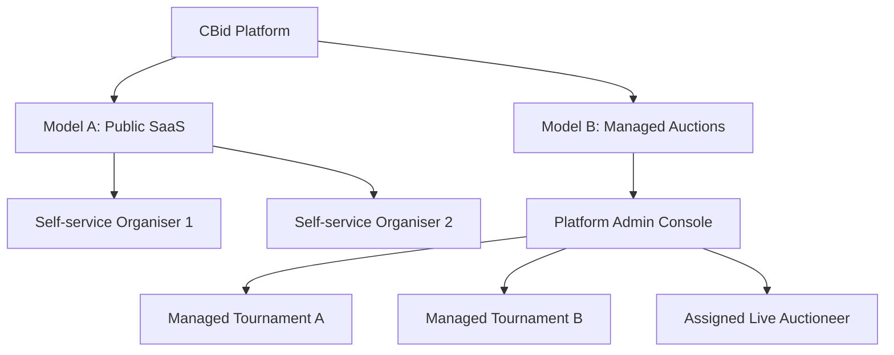
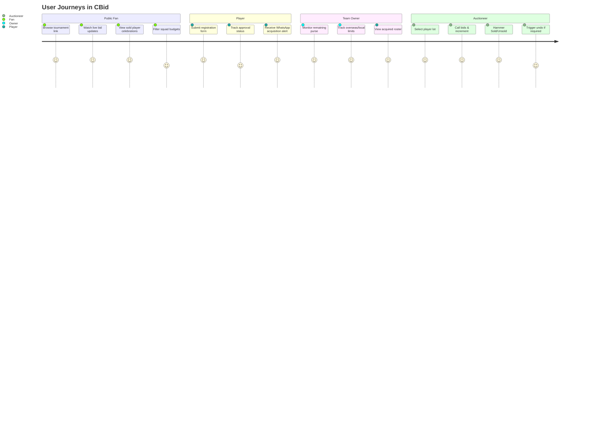

# Product Requirements Document (PRD) — CBid

## 1. Executive Summary & Vision

**CBid** is a commercial-grade, multi-tenant Cricket Auction Management Platform designed to streamline and elevate the entire lifecycle of professional, semi-pro, collegiate, and club cricket auctions.

Inspired by the information architecture of high-traffic broadcast trackers such as **Cricbuzz's Women's Premier League (WPL) Auction Tracker**, CBid bridges the gap between high-pressure administrative execution and captivating public fan engagement. It provides a real-time, broadcast-quality experience for cricket enthusiasts while equipping auctioneers with a low-latency, foolproof control cockpit.

### Core Value Propositions
1. **Zero-Latency Live Auction Experience:** Instantaneous synchronization across auctioneers, team tables, and tens of thousands of spectator devices via WebSockets (Socket.IO).
2. **Dual-Experience Architecture:** 
   - **Auctioneer Cockpit:** Ergonomic, high-density, keyboard-driven operational dashboard designed to eliminate human error under high-pressure live bidding.
   - **Public Spectator Experience:** A sports-broadcast visual tracker featuring live lot cards, animated bid counters, sold celebrations, squad trackers, and Cricbuzz-grade analytics.
3. **Multi-Tenant Flexibility:** Equal support for self-service SaaS organisers and white-glove, managed tournament operations.
4. **Financial Accuracy & Reserve Protection:** Mathematical guarantees that teams cannot inadvertently overspend or exhaust their purse before filling their mandatory minimum roster.

---

## 2. Competitive & Architectural Reference Analysis (Cricbuzz WPL Model)

Analyzing the Cricbuzz WPL Auction tracker reveals critical structural principles adapted into CBid:

| Cricbuzz Feature | Public User Intent | CBid Implementation & Enhancement |
| :--- | :--- | :--- |
| **Top Marquee Tracker** | Immediate visibility into currently contested player lot | Real-time animated Live Lot card with live timer, dynamic bid counter, and active bidder badge. |
| **Quick Filter Tabs** | Fast navigation across "All", "Sold", "Unsold", "Teams", "Stats" | Instant client-side faceted filtering with smooth Framer Motion layout animations. |
| **Purse Depletion Bar** | Track remaining team salary caps at a glance | Visual progress bars indicating Spent vs. Remaining vs. Reserved minimum squad budget. |
| **Category Breakdowns** | Understand bids across Batters, Bowlers, All-rounders, WKs | Multi-category tabs with role badges, overseas/local indicators, and price tags. |
| **Live Broadcast Ticker** | Chronological log of bids and events | WebSocket event feed with timestamps, bidding wars highlight, and instant sold alerts. |

---

## 3. Business Models & Tenancy Architecture

CBid supports two operational business models within a unified multi-tenant database:

### Model A: Public SaaS (Self-Service)
- Any cricket association, university, corporate, or private club organiser can register an account.
- Free and tiered subscription plans (e.g., Free Trial for 1 auction / 50 players; Pro Tournament for unlimited teams and WhatsApp integration).
- Complete isolation: Organisers manage their own tournaments, teams, players, and live sessions without seeing or impacting other tenants.

### Model B: Managed Auctions (Concierge Enterprise)
- Platform administrators configure, brand, and supervise tournaments on behalf of premium clients.
- Concierge auctioneers are assigned temporary operator credentials to run the live floor.
- Platform-level monitoring, live support interventions, and centralized billing.

---

## 4. User Personas & Target Workflows

1. **Platform Super Administrator:** Manages global settings, reviews system metrics, provisions managed auctions, monitors WhatsApp delivery rates, and conducts audit reviews.
2. **Tournament Organiser (Tenant Admin):** Configures rules, sets budgets, approves player registrations, invites teams, and oversees tournament completion.
3. **Live Auctioneer:** Operates the high-speed live auction control desk. Requires single-click or keyboard actions to advance bids, reset timers, and hammer lots.
4. **Team Representative / Owner:** Monitors their team's real-time purse balance, squad composition, and opponent spending.
5. **Cricket Player:** Registers via unique mobile-optimized portal, uploads verification photo and stats, and receives instant WhatsApp notification upon being acquired.
6. **Public Spectator / Cricket Fan:** Reads live updates, reviews squad rosters, filters statistics, and enjoys a real-time broadcast-quality experience with zero authentication.

---

## 5. Functional Requirements by Module

### 5.1 Overview & Tenant Dashboard
- Summary KPIs: Total Auctions, Active/Live Sessions, Scheduled Events, Registered Players, Verified Teams, Aggregate Turnover.
- Real-time tournament status chips (`DRAFT`, `SCHEDULED`, `LIVE`, `PAUSED`, `COMPLETED`).
- Quick actions: "Launch Live Floor", "New Registration Link", "Export Roster PDF/Excel".

### 5.2 Tournament & Auction Configuration Engine
- **Auction Modes:**
  - **Financial Auction:** Native support for Sri Lankan Rupee (`LKR`) with multi-currency abstraction (`USD`, `INR`, `AED`, `GBP`). Formatters support Millions, Crores, and Lakhs.
  - **Points Auction:** For school, internal club, and fantasy auctions operating on capped point allowances.
- **Financial & Squad Constraints:**
  - Base team purse (e.g., LKR 50,000,000 or 10,000 Points).
  - Minimum squad size (e.g., 15 players) and Maximum squad size (e.g., 20 players).
  - Overseas / International player caps (e.g., maximum 6 overseas players per squad).
  - Minimum base price across all tiers (used for squad completion reserve math).
- **Bid Increment Ladders:**
  - Configurable tiered increment tables. Example:
    - Below LKR 100,000 $\rightarrow$ + LKR 10,000
    - LKR 100,000 – LKR 500,000 $\rightarrow$ + LKR 25,000
    - LKR 500,000 – LKR 2,000,000 $\rightarrow$ + LKR 50,000
    - Above LKR 2,000,000 $\rightarrow$ + LKR 100,000
  - Custom increment override toggle for the auctioneer.
- **Timer Engine:**
  - Authoritative server timer with configurable countdown defaults (e.g., 15s, 30s, 45s).
  - Reset-on-bid option and manual pause/resume by auctioneer.

### 5.3 Player Registration & Roster Management
- **Public Registration Portal:** Unique URL per tournament (`/register/:auctionSlug`).
- Mobile-optimized responsive registration form:
  - Personal: Full name, profile photo upload (Cloudinary auto-crop), phone number with country code, email, age, city.
  - Cricket Profile: Primary role (Top-order Batter, Middle-order Batter, Wicketkeeper Batter, Pace All-rounder, Spin All-rounder, Fast Bowler, Spin Bowler).
  - Batting style (Right-hand bat, Left-hand bat), Bowling style (Right-arm fast, Left-arm orthodox, etc.), Jersey number preference.
  - Playing experience level (International, First Class, Domestic Club, University, School, Open).
  - Key statistics (matches, runs, highest score, wickets, economy, 50s/100s).
- **Organiser Review Pipeline:**
  - Batch approval/rejection interface with duplicate phone/email detection.
  - Base price assignment and Category tagging (e.g., Marquee, Category A, Category B, Emerging).
  - Bulk Excel/CSV import and export with schema validation and error reporting.

### 5.4 Team Management
- Team profile setup: Official team name, short acronym (e.g., "COL" for Colombo Lions), primary/secondary hex color, high-res team logo.
- Ownership metadata: Owner names, contact details, assigned table number.
- Squad constraint parameters: Minimum squad size, maximum squad size, max overseas quota.
- Real-time financial ledger: Starting purse, committed spend, remaining purse, reserved squad balance.

### 5.5 Live Auctioneer Control Cockpit (Operational Master)
- **Zero-Distraction Screen:** High-contrast, dark-mode cockpit optimized for 1080p+ displays and tablets.
- **Active Lot Centerpiece:** Player profile, photo, category, base price, current highest bid, leading team logo & name.
- **Instant Action Controls:**
  - Dynamic Bid Increment Buttons (`+10K`, `+25K`, `+50K`, `Custom`).
  - Quick Team Selector Grid (one-click assignment of the new highest bidder).
  - **HAMMER CONTROLS:**
    - "MARK SOLD" (triggers confirmation modal or immediate hammer with instant room broadcast).
    - "MARK UNSOLD" (records unsold event and advances queue).
    - "PASS / SKIP LOT" (defers player lot to later in the set).
  - **SAFEGUARD ACTIONS:**
    - "UNDO LAST BID" (rolls back to prior bid state with audit entry).
    - "PAUSE AUCTION" / "RESUME AUCTION".
  - Keyboard shortcuts (`Space` = Next Bid, `Enter` = Sold, `U` = Unsold, `P` = Pause, `Z` = Undo).

### 5.6 Public Auction Broadcast Experience (Cricbuzz Inspired)
- **Read-Only, High-Performance:** Scalable read architecture serving thousands of fans without touching transaction locks.
- **Live Lot View:** Dynamic animated card showing the player currently on the auction block, live timer bar, leading team badge, and bid tick animations.
- **Celebration Banners:** Full-screen or non-intrusive celebratory overlay when a player is hammered SOLD (featuring player photo, price in bold LKR, and winning franchise logo).
- **Cricbuzz-Style Explorer Tabs:**
  - **All Players:** Searchable, filterable by role, category, price bracket, and status.
  - **Sold Players:** Ordered by highest price, team, or chronological order.
  - **Unsold Players:** Comprehensive list with base prices and potential re-auction tags.
  - **Team Squads:** Card grid per team showing acquired players, role composition badges, and remaining purse.
  - **Auction Statistics:** Most expensive player, highest bids, team spending comparison charts, category expenditure breakdown.

### 5.7 WhatsApp Notification Subsystem
- **Provider:** Official Meta WhatsApp Cloud API (or Twilio WhatsApp Business API adapter).
- **Trigger:** Immediate trigger upon backend confirmation of a `PLAYER_SOLD` event.
- **Message Content:**
  - Player name.
  - Tournament name.
  - Winning franchise name.
  - Final acquisition price (formatted in LKR / Points).
  - Congratulatory link to official tournament squad page.
- **Reliability:** Idempotent job queue (BullMQ or MongoDB-backed task dispatcher), delivery status webhooks, exponential backoff retries.

---

## 6. Non-Functional & Operational Requirements

1. **Performance:** Under 100ms WebSocket broadcast latency for all live bid events to clients.
2. **Scalability:** Stateless backend application design capable of horizontal clustering behind a reverse proxy (Nginx).
3. **Data Integrity:** Zero double-spending of purses; strict atomic checks to ensure two simultaneous bids cannot corrupt auction state.
4. **Availability:** Resilience to client disconnects; full state rehydration upon client reconnection.
5. **Cross-Device Responsiveness:** Fluid adaptation across 4K displays, standard laptops, iPads/tablets, and mobile viewports (iOS/Android).

---

## 7. Open Questions & Critical Business Decisions for User Approval

> [!IMPORTANT]
> The following architectural and business decisions require confirmation before proceeding to subsequent implementation phases:

1. **Live Floor Bidding Authority:**
   - **Option A (Auctioneer-Driven - Recommended for Phase 1):** The auctioneer alone taps/calls the bids and selects the bidding team on the screen based on physical paddles or floor shouts.
   - **Option B (Interactive Team Bidding):** Each team owner has their own authenticated portal with a live "Place Bid" paddle button.
   - *Proposal:* Implement Option A first as requested, with database schemas and socket events architected to enable Option B seamlessly.
2. **WhatsApp API Provider Preference:**
   - **Option A (Meta WhatsApp Cloud API Direct):** Requires a Meta Business Account and System User Token; lowest message unit cost.
   - **Option B (Twilio Programmable Messaging):** Easier onboarding and setup; slightly higher per-message unit cost.
   - *Proposal:* Build a unified `NotificationService` interface with Meta Cloud API as default and Twilio as fallback switchable via `.env`.
3. **Unsold Player Re-Auction Flow:**
   - Should players marked `UNSOLD` be placed into an automated "Round 2 / Accelerated Queue" at the end of the auction, or should re-auctioning remain strictly manual via the auctioneer's lot selector?
   - *Proposal:* Provide both: an automated "Unsold Pool" tab in the auctioneer cockpit that allows one-click re-queueing of any unsold player.
4. **Currency Formatting Standards for LKR:**
   - Sri Lankan Rupees are conventionally written as `LKR 1,500,000` or in South Asian notation (`LKR 15 Lakhs`).
   - *Proposal:* Provide a user toggle in tournament settings between standard international numbering (`LKR 1.5M`) and Lakhs/Crores (`LKR 15 Lakhs`).
