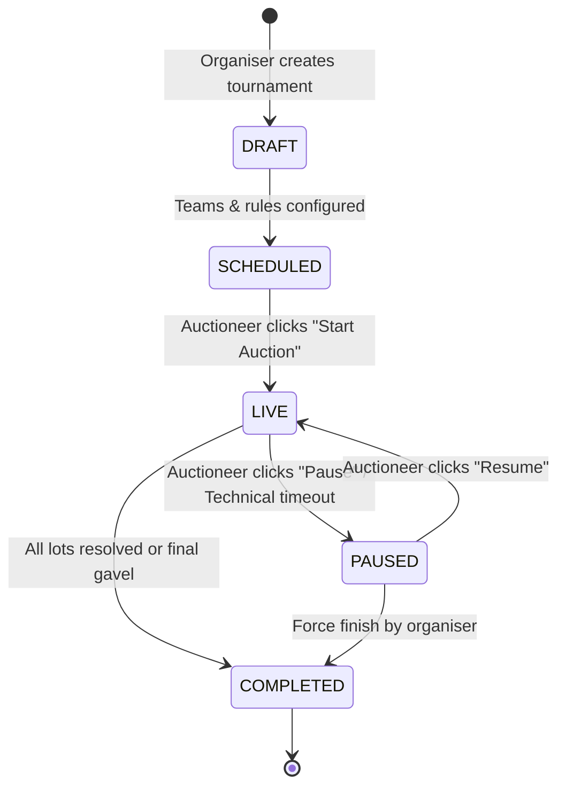
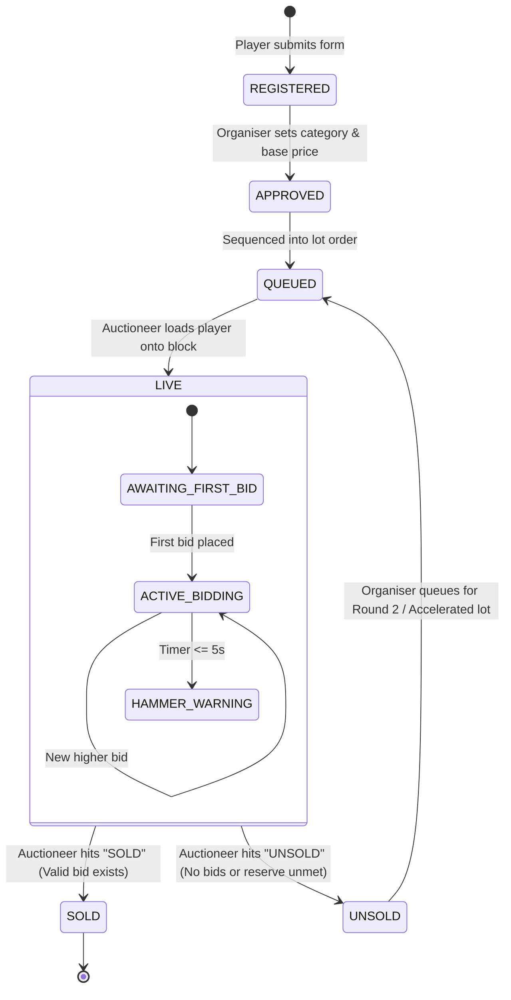

# Real-Time Auction Engine Specification — CBid

## 1. State Machine Architecture

The real-time auction engine is strictly backend-authoritative. The client UI acts purely as a reactive display and input dispatcher.

### 1.1 Auction Lifecycle State Machine



### 1.2 Player Lot State Machine



---

## 2. Complete Socket.IO Event Catalog

All real-time communications flow through isolated Socket.IO rooms.

### 2.1 Connection Handshake & Authentication
```javascript
// Client connection handshake
const socket = io("https://api.cbid.lk", {
  auth: {
    token: "Bearer <JWT_TOKEN>", // Optional for public spectators
    auctionId: "cpl-2026"
  }
});
```

### 2.2 Event Definitions

| Event Name | Direction | Room Target | Description |
| :--- | :---: | :---: | :--- |
| `auction:join` | Client $\rightarrow$ Server | - | Client requests to join auction room |
| `auction:state_sync` | Server $\rightarrow$ Client | Private Socket | Full initial state hydration upon join |
| `auction:lot_changed` | Server $\rightarrow$ Room | `auction:{id}` | New player brought to the live block |
| `auction:bid_placed` | Client $\rightarrow$ Server | - | Auctioneer/Bidder submits a bid |
| `auction:bid_updated` | Server $\rightarrow$ Room | `auction:{id}` | Broadcast of new leading bid and team |
| `auction:bid_rejected` | Server $\rightarrow$ Client | Caller Socket | Bid failed validation (with error code) |
| `auction:timer_tick` | Server $\rightarrow$ Room | `auction:{id}` | Server countdown broadcast |
| `auction:timer_paused` | Server $\rightarrow$ Room | `auction:{id}` | Timer paused by operator |
| `auction:timer_resumed` | Server $\rightarrow$ Room | `auction:{id}` | Timer resumed |
| `auction:player_sold` | Server $\rightarrow$ Room | `auction:{id}` | Lot hammered SOLD (triggers celebration) |
| `auction:player_unsold` | Server $\rightarrow$ Room | `auction:{id}` | Lot hammered UNSOLD |
| `auction:undo_action` | Client $\rightarrow$ Server | - | Auctioneer rolls back last bid/sale |
| `auction:state_reverted`| Server $\rightarrow$ Room | `auction:{id}` | State rolled back to prior snapshot |

---

## 3. Financial Validation & Budget Math

Every bid must pass a non-negotiable mathematical verification before it is accepted:

### The Reserve Fund Protection Formula
A team cannot place a bid that would leave them unable to fill the mandatory minimum squad slots with minimum base price players:

$$\text{Remaining Slots} = \max(0, \text{Min Squad Size} - \text{Current Squad Size} - 1)$$

$$\text{Mandatory Reserve} = \text{Remaining Slots} \times \text{Tournament Min Base Price}$$

$$\text{Max Permissible Bid} = \text{Team Remaining Purse} - \text{Mandatory Reserve}$$

$$\text{Validation Condition: } \text{Proposed Bid} \le \text{Max Permissible Bid}$$

### Squad Quotas Validation
- **Maximum Squad Size Check:** `team.squadCount < auction.maxSquadSize`
- **Overseas Quota Check:** If `player.isOverseas === true`, assert `team.overseasCount < auction.maxOverseasPlayers`.

---

## 4. Dynamic Bid Increment Ladder Algorithm

Increments automatically scale as the lot price rises according to the tournament's tier configuration:

```javascript
function calculateNextBid(currentBid, basePrice, incrementLadders) {
  if (currentBid === 0) {
    return basePrice; // Opening bid starts at base price
  }
  
  // Find matching tier
  const activeLadder = incrementLadders.find(
    ladder => currentBid >= ladder.from && (ladder.to === null || currentBid < ladder.to)
  );
  
  const step = activeLadder ? activeLadder.increment : 10000;
  return currentBid + step;
}
```

---

## 5. Server-Authoritative Timer & Drift Synchronization

To avoid timing discrepancies across different devices, CBid uses a **timestamp-target architecture** rather than sending a timer decrement every second:

1. When a lot opens or a bid is placed, the server computes:
   $$\text{timerExpiresAt} = \text{Date.now}() + (\text{timerSeconds} \times 1000)$$
2. The server broadcasts:
   ```json
   {
     "type": "auction:timer_started",
     "expiresAt": 1794503412000,
     "durationSeconds": 30
   }
   ```
3. The client calculates remaining time locally:
   $$\text{remainingMs} = \max(0, \text{expiresAt} - \text{Date.now}())$$
4. A low-frequency heartbeat (every 5 seconds) verifies synchronization and detects background tab suspension on client devices.
5. When `expiresAt <= Date.now()`, the server automatically fires the hammer warning or triggers the auto-unsold action if configured.

---

## 6. Undo & Compensation Workflow (Auctioneer Safety Net)

Live auctions are chaotic. If an auctioneer mistakenly attributes a bid to the wrong team or accidentally hammers sold:

1. **Bid Snapshot Stack:** The backend keeps an in-memory & database stack of the last 10 bid states for the active lot.
2. **Atomic Rollback:**
   ```javascript
   async function executeUndo(auctionId, userId) {
     const lastEvent = await Bid.findOneAndDelete(
       { auctionId },
       { sort: { bidSequence: -1 } }
     );
     
     if (!lastEvent) throw new Error("NO_BIDS_TO_UNDO");
     
     // Restore previous bid
     const previousBid = await Bid.findOne(
       { auctionId, playerId: lastEvent.playerId },
       { sort: { bidSequence: -1 } }
     );
     
     // Update active auction lot
     await Auction.updateOne(
       { _id: auctionId },
       {
         $set: {
           'currentLot.currentBid': previousBid ? previousBid.amount : 0,
           'currentLot.highestBidderTeamId': previousBid ? previousBid.teamId : null
         },
         $inc: { 'currentLot.bidCount': -1 }
       }
     );
     
     // Broadcast rollback
     io.to(`auction:${auctionId}`).emit("auction:state_reverted", {
       lotId: lastEvent.playerId,
       currentBid: previousBid ? previousBid.amount : 0,
       highestBidderTeamId: previousBid ? previousBid.teamId : null
     });
   }
   ```
3. **Audit Trail:** An immutable record of the reversal is written to `AuditLog`.
