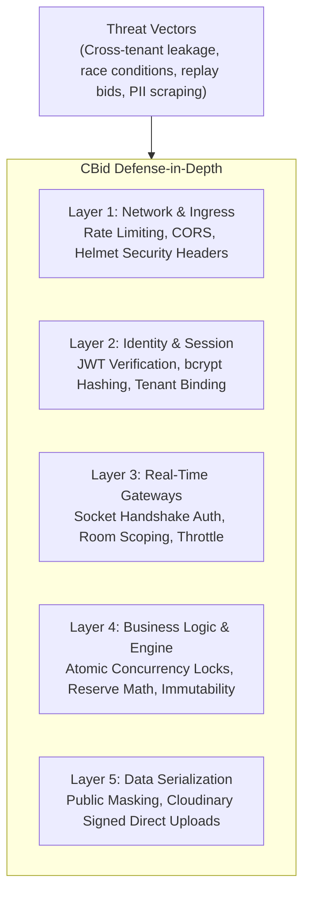

# Security & Tenant Isolation Plan — CBid

## 1. Threat Modeling & Security Objectives

As a commercial sports-tech platform handling high-stakes live auctions, private financial data, and player personal details, CBid enforces defense-in-depth across all system boundaries.



---

## 2. Authentication & Credential Security

1. **Password Hashing:** All user passwords hashed using **bcrypt** with a work factor of 12 salt rounds. Plaintext passwords never logged or persisted.
2. **Stateless JWT Tokens:** 
   - Cryptographically signed using `HS256` with strong 256-bit environment secrets.
   - Access tokens carry strict expiration (e.g., 2 hours).
   - Claims include `userId`, `role`, and `tenantId`.
3. **Session Invalidation:** Immediate token revocation via database-backed blacklists or user token versioning upon password resets or account suspensions.

---

## 3. Multi-Tenant Data Isolation Strategy

Data isolation is enforced at the middleware and database layer:

1. **Context Injection:** The `tenantMiddleware` extracts the tenant ID from the verified JWT and mounts `req.tenantId`.
2. **Query Scoping:** Service queries are unconditionally scoped to the active tenant:
   ```javascript
   // Secure scoped query pattern
   const player = await Player.findOne({ _id: playerId, tenantId: req.tenantId });
   if (!player) throw new NotFoundError("Player not found in tenant workspace");
   ```
3. **Prevention of Parameter Tampering:** Users cannot access or manipulate other tenants' auctions by modifying route parameters (`/api/v1/auctions/:id`). The middleware checks ownership before granting access.
4. **Super Admin Isolation Bypass:** Only authenticated users with `role: 'SUPER_ADMIN'` can query across tenant boundaries.

---

## 4. Real-Time Socket.IO Security

1. **Handshake Authentication:** Socket connections must supply a valid JWT or public viewer ticket during the initial connection handshake.
2. **Room Authorization Guards:** Clients can only join rooms they have explicit permissions for:
   - `auction:{id}:control` is restricted to authorized auctioneers and organisers. Public spectators attempting to join are rejected.
3. **Event Throttling & Flood Protection:** Inbound bid events are rate-limited to prevent automated bot flooding or denial-of-service on the auction engine.

---

## 5. Financial & Bidding Integrity Safeguards

1. **Backend-Authoritative Outcome:** The client never dictates bid acceptance, price calculations, or timer expirations.
2. **Atomic Mutex & Race Condition Prevention:** All bidding actions use MongoDB conditional atomic updates (`findOneAndUpdate` with exact matching current bid condition). Two simultaneous bids cannot both succeed.
3. **Reserve Fund Protection:** Mathematical guarantee that a team cannot spend money that would prevent them from meeting the minimum squad quota at minimum base price.
4. **Idempotent WhatsApp Alerts:** Unique transaction keys prevent double-messaging players if duplicate hammer events are processed.

---

## 6. Public Data Masking & PII Protection

To comply with data privacy standards and prevent player harassment:
- **Masked Public Fields:** Mobile numbers, WhatsApp numbers, email addresses, residential cities, and date of birth are strictly stripped from all public spectator API endpoints and WebSocket broadcast payloads.
- **Internal Financial Masking:** Internal organiser notes, team owner private contacts, and unspent reserve calculations are withheld from public view.

---

## 7. Media & Upload Security (Cloudinary)

- **Direct Uploads via Signed Tokens:** Frontend uploads images directly to Cloudinary using time-limited signatures generated by the backend.
- **MIME-Type & Extension Whitelisting:** Strict restriction to `image/jpeg`, `image/png`, and `image/webp`. Executables and SVG scripts are blocked.
- **File Size Capping:** Profile photos capped at 5MB; team logos capped at 3MB.

---

## 8. Network, HTTP & Infrastructure Defense

1. **Helmet Headers:** Automatic injection of `Content-Security-Policy`, `X-Content-Type-Options: nosniff`, and `Strict-Transport-Security`.
2. **CORS Whitelisting:** Specific domain matching for staging and production; wildcard origins strictly prohibited for authenticated API routes.
3. **Rate Limiting:**
   - Public registration endpoints: 10 requests / minute per IP.
   - Authentication login: 5 failed attempts / 15 minutes per IP.
   - Public spectator reads: 120 requests / minute per IP.
4. **NoSQL Injection & Sanitization:** Use of `express-mongo-sanitize` to strip `$` and `.` operators from client inputs.
