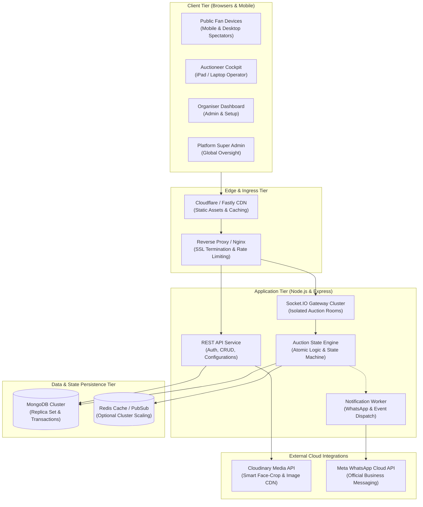
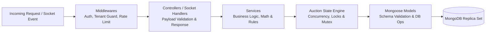
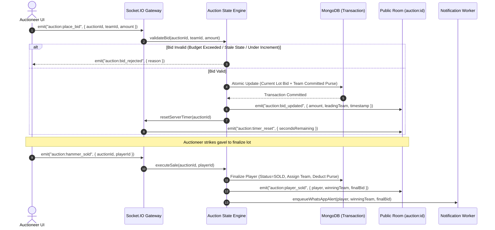

# System Architecture Specification — CBid

## 1. High-Level Architectural Topology

CBid is structured as a modern, decoupled client-server platform optimized for high concurrency, ultra-low latency WebSocket communications, and strict multi-tenant isolation.



---

## 2. Frontend Architecture (React + Vite + Tailwind + Framer Motion)

### 2.1 Technology Stack & Rationale
- **Framework:** React 18 with Vite for ultra-fast HMR and optimized production bundles.
- **Language:** JavaScript & JSX (strict compliance with project constraints).
- **Styling:** Tailwind CSS with custom sports-tech color tokens, elevation layers, and custom typography variables.
- **Animation Engine:** Framer Motion for hardware-accelerated 60fps layout animations, spring physics, and animated numbers.
- **Icons:** Lucide React for consistent, lightweight SVGs.
- **Routing:** React Router v6 with code-splitting via `React.lazy` and `Suspense`.

### 2.2 Directory Structure
```
frontend/src/
├── assets/                  # Logos, cricket role badges, sound effects
│   ├── audio/               # Hammer sound, bid beep, countdown chime
│   └── images/              # Default player placeholder, pitch backgrounds
├── components/              # Shared atomic and molecule components
│   ├── ui/                  # Button, Modal, Input, Badge, Dropdown, Skeleton
│   ├── feedback/            # Toast notification, Confetti burst, Alert banner
│   └── navigation/          # Sidebar, Navbar, Breadcrumbs, TabGroup
├── context/                 # Global state providers
│   ├── AuthContext.jsx      # User profile, tokens, role-based capabilities
│   ├── AuctionContext.jsx   # Active auction state, lot data, bid history
│   └── SocketContext.jsx    # Socket.IO connection manager & reconnect logic
├── hooks/                   # Custom business logic hooks
│   ├── useAuctionRoom.js    # Subscribes to live auction room events
│   ├── useAuthoritativeTimer.js # High-precision countdown synchronized with server
│   ├── useKeyboardShortcuts.js  # Keyboard controls for auctioneer cockpit
│   └── useSoundEffects.js   # Audio triggers for hammer and bids
├── layouts/                 # Page wrappers
│   ├── AuctioneerLayout.jsx # Immersive, zero-scroll cockpit layout
│   ├── PublicLayout.jsx     # Fan-focused broadcast tracker layout
│   ├── DashboardLayout.jsx  # Organiser admin sidebar layout
│   └── AuthLayout.jsx       # Clean centered authentication layout
├── pages/                   # Application views
│   ├── auctioneer/          # LiveControlCockpit, LotQueueManager
│   ├── public/              # PublicLiveTracker, PlayerDirectory, SquadExplorer
│   ├── organiser/           # Tournaments, PlayerApprovals, TeamManager, Analytics
│   ├── registration/        # MobilePublicRegistrationForm, SuccessView
│   └── admin/               # SuperAdminTenants, GlobalSettings, AuditLogs
├── services/                # Network clients
│   ├── api.js               # Axios instance with auth interceptor
│   ├── auctionService.js    # REST calls for auction CRUD
│   ├── playerService.js     # Player registration & Excel upload
│   └── socket.js            # Socket client factory
└── utils/                   # Pure utility functions
    ├── currency.js          # LKR and South Asian formatting
    ├── cricket.js           # Role badges and stats calculations
    └── motion.js            # Framer motion preset variants
```

### 2.3 State Management & React Context Topology
1. **`AuthContext`:** Manages JWT storage (in memory with refresh token flow or secure storage), current user identity, and tenant boundary.
2. **`SocketContext`:** Establishes and monitors WebSocket connection health, exposes connection status (`connected`, `reconnecting`, `disconnected`), and handles auto-reconnect backoff.
3. **`AuctionContext`:** Stores the active auction room state (current lot, leading team, bid ladder, timer seconds, recent bids, team budget summaries) and dispatches reducer actions on socket events.

---

## 3. Backend Architecture (Node.js + Express + MongoDB + Socket.IO)

### 3.1 Architectural Pattern: Layered Modular Architecture
The backend is structured into distinct layers to guarantee separation of concerns, testability, and maintainability:



### 3.2 Backend Directory Structure
```
backend/src/
├── config/                  # Environment variables, DB connection, Cloudinary config
│   ├── db.js                # Mongoose connection with pool sizing
│   ├── cloudinary.js        # Media storage setup
│   ├── whatsapp.js          # WhatsApp Business API client config
│   └── constants.js         # Auction states, roles, error codes
├── controllers/             # HTTP route handlers
│   ├── authController.js
│   ├── auctionController.js
│   ├── playerController.js
│   ├── teamController.js
│   ├── registrationController.js
│   └── adminController.js
├── middlewares/             # Request interceptors
│   ├── authMiddleware.js    # JWT verification
│   ├── tenantMiddleware.js  # Tenant context binding & isolation guard
│   ├── roleMiddleware.js    # RBAC permission check
│   ├── rateLimiter.js       # express-rate-limit instances
│   └── errorHandler.js      # Structured JSON error responses
├── models/                  # Mongoose schemas
│   ├── User.js
│   ├── Tenant.js
│   ├── Auction.js
│   ├── Team.js
│   ├── Player.js
│   ├── PlayerRegistration.js
│   ├── Bid.js
│   ├── PlayerAcquisition.js
│   ├── AuctionEvent.js
│   ├── NotificationLog.js
│   └── AuditLog.js
├── routes/                  # Express API route maps
│   ├── authRoutes.js
│   ├── auctionRoutes.js
│   ├── playerRoutes.js
│   ├── teamRoutes.js
│   ├── registrationRoutes.js
│   └── adminRoutes.js
├── services/                # Core domain business logic
│   ├── auctionEngine.js     # State machine, bid processing, hammer logic
│   ├── timerService.js      # Server-authoritative lot ticker
│   ├── notificationService.js # WhatsApp dispatcher with retry queue
│   ├── uploadService.js     # Cloudinary signed uploads & auto-crop
│   └── excelService.js      # Bulk player parsing & validation
├── sockets/                 # Real-time WebSocket handlers
│   ├── socketServer.js      # Socket.IO initialization & auth handshake
│   └── auctionHandlers.js   # Join room, bid placed, hammer events
└── utils/                   # Helpers
    ├── apiResponse.js       # Standardized response envelopes
    ├── logger.js            # Structured Winston/Pino logger
    └── formatters.js        # Number & date formatters
```

---

## 4. Real-Time WebSocket Architecture (Socket.IO)

### 4.1 Room Segregation & Isolation
To prevent data contamination and ensure efficiency, WebSockets utilize strict room namespacing:
- `auction:{auctionId}` — Public Spectator Room: Receives sanitized, read-only live broadcast events (lot updates, current bid, leading team, timer tick, sold/unsold alerts).
- `auction:{auctionId}:control` — Private Auctioneer Cockpit Room: Receives sensitive operational telemetry, undo availability, and floor logs.
- `tenant:{tenantId}` — Tenant Administration Room: Receives background registration counters and tournament health updates.

### 4.2 Authoritative Bid Processing Flow


---

## 5. Third-Party Integrations

### 5.1 Cloudinary (Smart Media Pipeline)
- **Use Case:** High-resolution player portraits and franchise logos.
- **Transformations:** Automated face-detection crop (`c_thumb,g_face,w_400,h_500`), webp auto-format delivery (`f_auto,q_auto`).
- **Security:** Signed upload signatures generated on the backend; client uploads directly to Cloudinary CDN to prevent server bottleneck.

### 5.2 Meta WhatsApp Cloud API (Transactional Alerts)
- **Use Case:** Instant player notification when acquired in an auction.
- **Integration Mode:** Graph API endpoint (`https://graph.facebook.com/v21.0/{phone-number-id}/messages`) with pre-approved message templates:
  - Template: `cricket_player_acquired_v1`
  - Parameters: `{{1}}` (Player Name), `{{2}}` (Tournament Name), `{{3}}` (Franchise Name), `{{4}}` (Acquisition Price).
- **Extensibility:** Abstracted behind `NotificationService` interface. Easily swapped or backed up by Twilio WhatsApp API.

---

## 6. Multi-Tenancy Architecture

CBid implements a **Shared Database, Logical Isolation (Tenant-Keyed)** model:
1. Every collection document contains a `tenantId` (referencing the owning Organiser).
2. The `tenantMiddleware` extracts the tenant context from the authenticated user token or the public tournament URL slug.
3. Mongoose query interceptors and service methods automatically append `{ tenantId }` to prevent data leakage across tournaments.
4. Storage quotas and limits are checked at the service layer prior to record creation.
