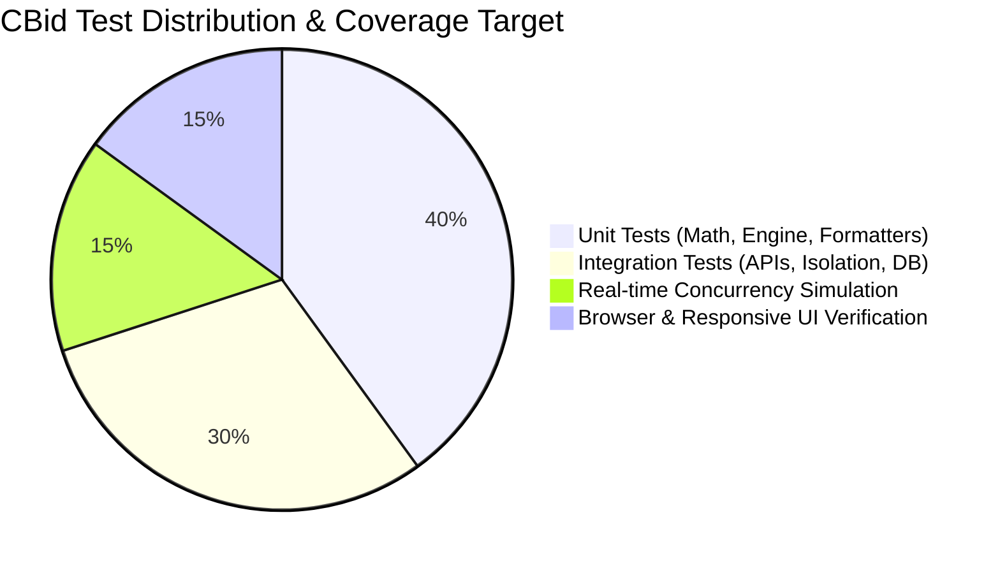
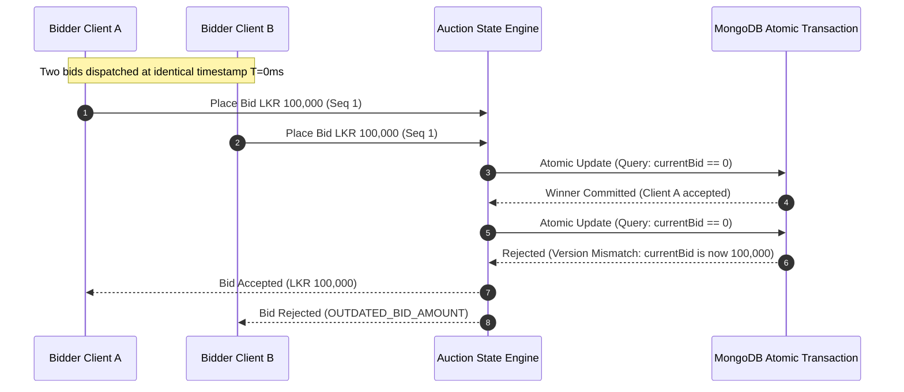

# Quality Assurance & Testing Strategy — CBid

## 1. Testing Pyramid & QA Philosophy

Because CBid powers live auctions with real financial commitments and high participant stakes, our testing strategy prioritizes **correctness under concurrent load**, **state consistency**, and **visual excellence**.

---

## 2. Unit Testing (Domain Logic & Mathematical Invariants)

Unit tests focus on deterministic pure functions and domain rules using a modern test runner:

### 2.1 Test Cases & Coverage
1. **Reserve Fund Protection Math:**
   - Verify that bids are rejected when `remainingPurse - bid < (minSquadSize - currentSquad - 1) * minBasePrice`.
   - Test edge cases where a team has 1 slot left vs. 5 slots left.
   - Verify calculation when `currentSquad >= minSquadSize` (no reserve required up to `maxSquadSize`).
2. **Bid Increment Ladders:**
   - Verify increment steps at exact bracket thresholds (e.g. at 99,999 vs 100,000 vs 500,000).
   - Test custom organizer increment ladders.
3. **Currency & Cricket Formatters:**
   - Format `50000000` $\rightarrow$ `LKR 5.00 Cr` (South Asian) vs `LKR 50.00 M` (Standard).
   - Verify player bowling averages and strike rate calculations.
4. **Authoritative Countdown Calculations:**
   - Verify remaining milliseconds calculation against drift and time offset.

---

## 3. Backend Integration Testing (API & Database)

Integration tests verify API contracts and database interactions using Supertest and an in-memory/test MongoDB instance:

### 3.1 Test Suites
- **Tenant Isolation Assertions:**
  - Authenticate as Tenant A; attempt to read/update an auction owned by Tenant B. Assert `403 Forbidden` or `404 Not Found`.
- **RBAC Endpoint Permissions:**
  - Assert that `AUCTIONEER` cannot modify tournament rules or delete teams.
  - Assert that unauthenticated requests to private endpoints return `401 Unauthorized`.
- **Public Serialization Sanity:**
  - Query public endpoints (`/api/v1/public/auctions/:slug/players`) and assert that fields `contactNumber`, `email`, and `ownerContact` are strictly absent.

---

## 4. Real-Time Concurrency & Race Condition Simulation

The most critical test for CBid is verifying that high-speed simultaneous bids do not corrupt auction state or double-spend purses.

### Concurrency Stress Test Script
- Dispatch 50 concurrent simulated WebSocket bid requests across 5 mock team clients targeting the same lot.
- **Assertion:** Exactly 1 bid advances the lot price; remaining 49 bids receive graceful rejection events with zero state corruption.

---

## 5. Browser-Based Verification & Responsive UI Testing

Per Antigravity rules, UI quality is verified in the live running application:

### 5.1 Viewport Matrix
| Viewport Profile | Resolution | Key Verification Focus |
| :--- | :--- | :--- |
| **Desktop Ultra** | $1920 \times 1080$ | High-density auctioneer cockpit; keyboard shortcuts; multi-column stats |
| **Laptop Standard** | $1366 \times 768$ | Cockpit zero-scroll fit; live lot card prominence |
| **Tablet Landscape** | $1024 \times 768$ | Touch targets for auctioneer paddles; quick team selector grid |
| **Mobile Portrait** | $375 \times 812$ | Public spectator broadcast view; live lot card; player registration form |

### 5.2 Motion & Visual Regression Verification
1. Confirm 60fps rendering during bid increments and countdown ticker.
2. Verify SOLD celebration overlay triggers smoothly without DOM lag.
3. Verify that when `prefers-reduced-motion` is enabled, heavy animations are cleanly bypassed.

---

## 6. WhatsApp Notification & Webhook Simulation

- **Integration Mocking:** Use a mock WhatsApp API server during CI/CD to simulate Meta Cloud API responses.
- **Delivery Webhook Test:** Simulate incoming delivery receipt webhooks (`SENT` $\rightarrow$ `DELIVERED` $\rightarrow$ `READ`) and assert database update in `NotificationLog`.
- **Retry Logic:** Simulate API 500 error and verify that the worker schedules exponential backoff retry.
