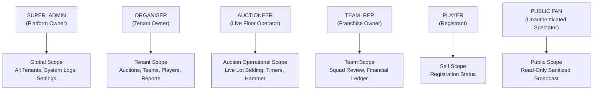

# User Roles & Multi-Tenant Permissions — CBid

## 1. Role-Based Access Control (RBAC) Architecture

CBid enforces strict role-based access control coupled with multi-tenant workspace boundaries. Every administrative, operational, or spectator interaction is authenticated and authorized according to the principle of least privilege.



---

## 2. Granular Permission Matrix

| Module & Action | SUPER_ADMIN | ORGANISER | AUCTIONEER | TEAM_REP | PUBLIC FAN |
| :--- | :---: | :---: | :---: | :---: | :---: |
| **Platform Management** | | | | | |
| View System Logs & Analytics | ✅ | ❌ | ❌ | ❌ | ❌ |
| Create / Suspend Tenants | ✅ | ❌ | ❌ | ❌ | ❌ |
| Manage Global WhatsApp Settings | ✅ | ❌ | ❌ | ❌ | ❌ |
| **Auction Management** | | | | | |
| Create & Configure Tournaments | ✅ | ✅ | ❌ | ❌ | ❌ |
| Update Rules & Bid Ladders | ✅ | ✅ | ❌ | ❌ | ❌ |
| Delete Draft Tournaments | ✅ | ✅ | ❌ | ❌ | ❌ |
| View Public Auction Broadcast | ✅ | ✅ | ✅ | ✅ | ✅ |
| **Live Auction Cockpit** | | | | | |
| Start / Pause / Resume Auction | ✅ | ✅ | ✅ | ❌ | ❌ |
| Select Next Player Lot | ✅ | ✅ | ✅ | ❌ | ❌ |
| Place Bid (Select Team & Increment)| ✅ | ✅ | ✅ | ❌* | ❌ |
| Hammer SOLD / UNSOLD | ✅ | ✅ | ✅ | ❌ | ❌ |
| Rollback / Undo Last Action | ✅ | ✅ | ✅ | ❌ | ❌ |
| **Player & Roster Administration** | | | | | |
| Review / Approve Registrations | ✅ | ✅ | ❌ | ❌ | ❌ |
| Assign Base Price & Category | ✅ | ✅ | ❌ | ❌ | ❌ |
| Bulk Excel Import / Export | ✅ | ✅ | ❌ | ❌ | ❌ |
| View Player Contact Info (Phone) | ✅ | ✅ | ❌ | ❌ | ❌ (Masked) |
| Submit Public Registration Form | ✅ | ✅ | ✅ | ✅ | ✅ |
| **Team Management** | | | | | |
| Create / Edit Teams & Budgets | ✅ | ✅ | ❌ | ❌ | ❌ |
| View Team Financial Ledger | ✅ | ✅ | ✅ | ✅ (Own Team) | ✅ (Summary) |

*\*Note: In Phase 8, interactive direct bidding for `TEAM_REP` can be enabled conditionally per tournament configuration.*

---

## 3. Multi-Tenant Workspace Boundary Enforcement

### 3.1 Context Propagation via JWT Claims
Upon successful authentication, the backend generates an HMAC SHA-256 JWT containing identity and tenant claims:
```json
{
  "userId": "6732f1a8c9b2e04f9810ab12",
  "role": "ORGANISER",
  "tenantId": "6732f1a8c9b2e04f9810aa01",
  "assignedAuctions": ["6732f1a8c9b2e04f9810bb05"],
  "iat": 1794500000,
  "exp": 1794586400
}
```

### 3.2 Express Middleware Stack
All secured endpoints pass through a composite verification pipeline:

```javascript
// Example middleware chain:
router.post(
  '/api/v1/auctions/:auctionId/players',
  authenticateToken,     // 1. Validates JWT and attaches req.user
  tenantGuard,           // 2. Asserts req.user.tenantId matches auction.tenantId
  requireRole(['ORGANISER', 'SUPER_ADMIN']), // 3. Asserts role permission
  validatePlayerInput,   // 4. Schema payload validation
  createPlayerController // 5. Executes business logic
);
```

### 3.3 Guarding Against Cross-Tenant Attacks
1. **URL Parameter Tampering:** Even if an attacker manipulates `:auctionId` or `:tenantId` in the URL, the `tenantGuard` verifies that the target document belongs strictly to `req.user.tenantId`.
2. **Super Admin Exemption:** The `SUPER_ADMIN` role bypasses tenant scoping, allowing administrative intervention and support across managed auctions.

---

## 4. Public API Data Masking & Serialization

To protect player privacy and tournament proprietary data, public endpoints (e.g. `/api/v1/public/auctions/:slug/*`) pass all outgoing payloads through serialization mappers.

### Data Masking Rules
1. **Player Personal Contact:**
   - Private (`ORGANISER` view): `phone: "+94771234567"`, `email: "kusal@cricket.lk"`
   - Public view: Both fields are completely **stripped** from the JSON payload.
2. **Team Internal Financials:**
   - Private view: Exact reserved purse calculation, internal owner notes, payment transaction logs.
   - Public view: Starting purse, remaining purse, total spent, squad count, acquired players.
3. **Audit Records:**
   - Private view: Actor IP address, user agent, internal user ID.
   - Public view: Public event timeline (e.g., "Player Kusal Mendis sold to Colombo Strikers for LKR 2,500,000 at 19:45").
